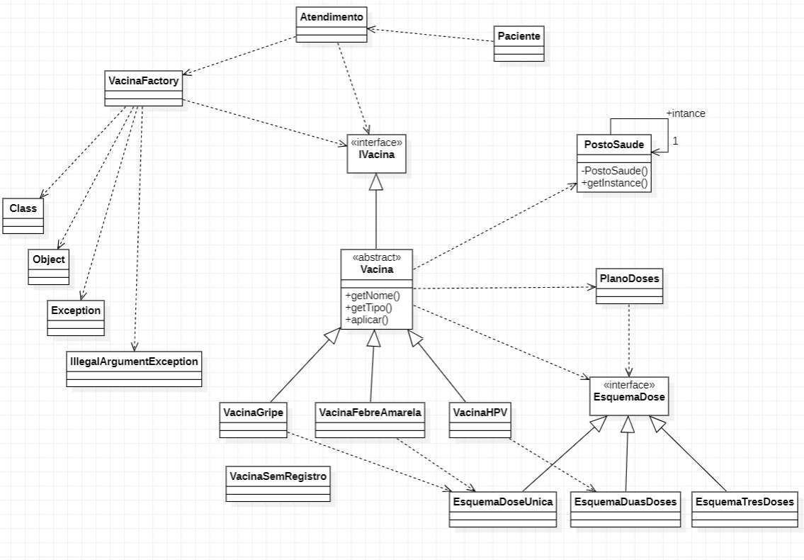

# Desafio integração de padrões Strategy, Factory Method, Template Method e Singleton, Vacinação em Posto de Saúde

#### Nome: João Vitor Fernandes Ribeiro Carneiro Ramos
#### Matrícula: 202165076C

Implementação dos padrões de projeto **Strategy**, **Factory Method**, **Template Method** e **Singleton** em Java.

## Diagrama UML

